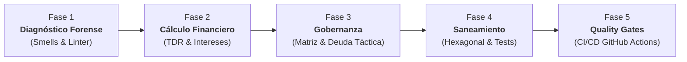

# Taller Deuda Técnica: Auditoría Forense, Gobernanza de Deuda Técnica y CI/CD Quality Gates
> **Entregable:** Repositorio en GitHub con código refactorizado, suite de pruebas automatizadas, pipeline de CI/CD activo e Informe de Auditoría diligenciado (`INFORME_AUDITORIA.md`).

---

## 1. Escenario Empresarial: «FastPay Global»

La fintech multinacional **«FastPay Global»** procesa suscripciones y cobros recurrentes en varios países a través de su microservicio estrella (`fastpay-billing-service`). Durante el último trimestre, la empresa ha experimentado una crisis operativa:
* **Múltiples caídas los fines de semana:** Bloqueos en el Event Loop y saturación de conexiones.
* **Quejas masivas por cobros duplicados:** Clientes con facturación doble o quíntuple ante reintentos de red.
* **Rotación del 60% en el equipo de desarrollo:** Los ingenieros renuncian alegando que el código es *"imposible de entender, modificar o testear"*.
* **Presión de auditoría y congelamiento de despliegues:** La junta directiva y el equipo de cumplimiento congelaron cualquier nuevo release hasta presentar una **auditoría forense formal**, calcular el **Technical Debt Ratio (TDR)** y refactorizar el servicio bajo estándares internacionales (**ISO/IEC 25010** e **ISO/IEC/IEEE 12207**).

Tu equipo ha sido contratado como **Consultores Senior de Arquitectura y Calidad de Software** para sanear el servicio, establecer la gobernanza de deuda técnica y blindar el pipeline de despliegue continuo.

---

## 2. Estructura del Proyecto Starter

El código base heredado se encuentra en la carpeta [`fastpay-service/`](./fastpay-service/):

```text
taller-casa/
├── GUIA_TALLER_CASA.md             # Esta guía metodológica
├── INFORME_AUDITORIA_TEMPLATE.md   # Plantilla obligatoria para el informe de entrega
└── fastpay-service/                # Microservicio legado endeudado
    ├── package.json                # Configuración de dependencias y scripts
    ├── .eslintrc.json              # Reglas de análisis estático
    ├── data/
    │   ├── subscriptions.json      # Base de datos en archivo plano (susceptible a race conditions)
    │   └── incidents-history.json  # Bitácora de incidentes reales del último trimestre
    ├── src/
    │   ├── server.js               # Servidor Express acoplado directamente al motor
    │   └── legacy_billing_engine.js# God Method monolítico con alta complejidad y smells
    ├── scripts/
    │   └── simulate_billing.js     # Simulador de concurrencia y cobros duplicados
    └── test/
        └── legacy.test.js          # Pruebas insuficientes y frágiles
```

###  Puesta en marcha inicial del microservicio:
```bash
cd taller-casa/fastpay-service

# 1. Ejecutar las pruebas legacy existentes:
npm test

# 2. Reproducir la incidencia de cobro duplicado y race condition:
npm run simulate

# 3. Inspeccionar violaciones estáticas de complejidad y buenas prácticas:
npm run lint
```

---

## 3. Procedimiento Metodológico en 5 Fases

El taller no consiste en "borrar y rehacer el código", sino en ejecutar el **Ciclo de Vida de Gestión de Deuda Técnica**:



---

### Fase 1: Diagnóstico Forense y Detección de Smells
1. **Reproducción de Fallos Operativos:**
   * Ejecutar `node scripts/simulate_billing.js`. Documentar en el informe por qué el servicio cobró múltiples veces al mismo cliente y cómo el archivo `subscriptions.json` quedó con inconsistencia de saldos.
2. **Análisis Estático y Seguridad:**
   * Ejecutar `npm run lint` y registrar los errores de complejidad ciclomática (`complexity`), profundidad de anidamiento (`max-depth`) y variables no declaradas/no usadas.
   * Ejecutar `npm audit` para detectar riesgos en librerías de terceros.
3. **Catálogo de Deuda Técnica:**
   * Identificar y catalogar al menos **5 anomalías técnicas críticas** en el código:
     * *God Method / Large Class*
     * *Primitive Obsession* (manejo de moneda/dinero con coma flotante)
     * *Race Condition / Inconsistencia transaccional*
     * *Credenciales y secretos hardcodeados*
     * *Acoplamiento a I/O síncrono bloqueante (`fs.readFileSync`)*

---

### Fase 2: Cuantificación Financiera (Principal vs. Intereses)
La deuda técnica se comporta como una deuda financiera: genera un **Principal** (costo de arreglarla) y cobra **Intereses recurrentes** (tiempo perdido y pérdidas operativas).

1. **Análisis de la Bitácora de Incidentes:**
   * Analizar el archivo `data/incidents-history.json` correspondiente al último trimestre de FastPay Global.
   * Calcular la sumatoria de:
     * Horas totales de indisponibilidad (Downtime).
     * Pérdidas financieras en reembolsos de clientes ($ USD).
     * Horas de ingeniería perdidas por los desarrolladores atendiendo incidentes fuera de horario.
2. **Clasificación en el Cuadrante de Martin Fowler:**
   * Clasificar cada hallazgo del catálogo en los 4 cuadrantes (*Deliberada/Inadvertida $\times$ Prudente/Temeraria*).
3. **Mapeo a la Norma ISO/IEC 25010:**
   * Mapear cada hallazgo contra las subcaracterísticas de calidad de software: *Mantenibilidad (Modularidad, Reusabilidad, Analizabilidad, Modificabilidad, Testeabilidad)*, *Seguridad (Confidencialidad)* o *Fiabilidad (Tolerancia a fallos, Recuperabilidad)*.
4. **Cálculo del TDR (Technical Debt Ratio):**
   * Estimar el **Principal ($P$)** total en horas de desarrollo multiplicadas por una tarifa estándar de mercado ($45 USD/h).
   * Estimar el **Costo Total de Desarrollo ($C$)** del microservicio.
   * Aplicar la fórmula:
     $$\text{TDR} = \frac{\text{Principal de Remediación}}{\text{Costo de Reconstrucción del Sistema}} \times 100$$
   * Calcular el tiempo de retorno de inversión (**ROI**): ¿En cuántos meses el refactor se paga a sí mismo al eliminar los incidentes?

---

### Fase 3: Gobernanza y Toma de Decisiones Técnicas
En el mundo profesional, los recursos son limitados y **no toda la deuda puede pagarse de inmediato**.

1. **Construir la Matriz de Priorización:**
   * Ubicar cada ítem en una matriz 2x2: **Impacto en el Negocio vs. Esfuerzo de Implementación**.
   * Determinar qué ítems entran obligatoriamente en el plan de pago inmediato (Sprint 1) y cuáles se postergan.
2. **Registro Formal de Deuda Táctica Deliberada (Technical Debt Register):**
   * El equipo debe simular una decisión consciente de negocio: **asumir o diferir un ítem de deuda técnica deliberada y prudente** (por ejemplo: posponer la migración a una base de datos distribuida manteniendo persistencia local segura o simular una pasarela externa con stubs en memoria).
   * Documentar este ítem en la plantilla con: Justificación de negocio, Riesgo asumido, Medida paliativa/temporal y Fecha límite de pago (**Debt Ceiling**).

---

### Fase 4: Red de Seguridad y Modernización Hexagonal
1. **Pruebas de Caracterización (Golden Master Testing):**
   * **REGLA DE ORO:** Está prohibido tocar el código de negocio sin antes construir una suite de pruebas de caracterización que "congele" las reglas válidas existentes (cálculo de impuestos por país, promociones válidas).
   * Crear pruebas en `test/characterization.test.js` usando `node:test` y `node:assert`.
2. **Refactorización a Arquitectura Hexagonal (Puertos y Adaptadores):**
   * Reorganizar el código desacoplando completamente las dependencias:
     ```text
     src/
     ├── domain/          # Entidades puras (Subscription, Money, TaxRule), sin Express ni fs
     ├── application/     # Casos de uso (ProcessBilling, CancelSubscription)
     ├── ports/           # Interfaces abstractas (PaymentGatewayPort, SubscriptionRepositoryPort)
     └── infrastructure/  # Adaptadores (ExpressController, FileSubscriptionRepository, MockStripeGateway)
     ```
3. **Buenas Prácticas de Dominio:**
   * Implementar un **Value Object** para `Money` que evite el bug de coma flotante (manejo de centavos enteros o redondeo seguro).
   * Introducir un mecanismo de **idempotencia o bloqueo** para que peticiones concurrentes nunca cobren dos veces la misma suscripción en el mismo período.
   * Aislar secretos en variables de entorno (`.env` con valores seguros por defecto en `.env.example`).
4. **Cobertura de Pruebas:**
   * Cobertura de pruebas unitarias superior al **80%** en la capa de dominio y aplicación (`npm test -- --coverage` o equivalente).

---

### Fase 5: Quality Gates Automatizados en CI/CD (GitHub Actions)
1. **Configurar el flujo de trabajo en `.github/workflows/quality-gate.yml`**:
   * El pipeline debe ejecutarse en cada `push` y `pull_request` hacia la rama `main`.
   * **Gate 1:** Verificación estática con linter (`npm run lint`).
   * **Gate 2:** Auditoría de seguridad de dependencias (`npm audit --audit-level=high`).
   * **Gate 3:** Ejecución de pruebas unitarias y cálculo de cobertura.
   * **Gate 4:** Bloqueo formal del pipeline si la cobertura es $< 80\%$ o si hay violaciones críticas de linter.
2. **Evidencia Forense de Protección:**
   * Evidenciar en el informe una captura o log de un **Pull Request que fue rechazado/bloqueado automáticamente** por fallar el Quality Gate (ej. se introdujo un fallo deliberado o se bajó la cobertura).
   * Evidenciar el **Pull Request final aprobado** con todos los checks en verde.

---

## 4. Estructura del Informe Final (`INFORME_AUDITORIA.md`)

Los estudiantes deben copiar y diligenciar la plantilla [`INFORME_AUDITORIA_TEMPLATE.md`](./INFORME_AUDITORIA_TEMPLATE.md) ubicándola en la raíz de su repositorio como `INFORME_AUDITORIA.md`. Debe contener:
* Resumen ejecutivo y tabla comparativa de métricas (antes vs. después).
* Inventario de deuda técnica con clasificación Fowler e ISO/IEC 25010.
* Análisis forense de `incidents-history.json`, cálculo de TDR y ROI.
* Matriz de priorización y registro de deuda táctica deliberada.
* Explicación de la arquitectura hexagonal y red de pruebas.
* Evidencias de los Quality Gates en GitHub Actions (PR bloqueado y PR verde).
* Conclusiones de gobernanza continua según ISO/IEC/IEEE 12207.

---

## 5. Rúbrica de Evaluación

| Criterio | Excelente (4.8 - 5.0) | Aceptable (3.5 - 4.7) | Insuficiente (< 3.5) |
| :--- | :--- | :--- | :--- |
| **Diagnóstico Forense y Finanzas Técnicas (25%)** | Cuantifica con exactitud el Principal y los Intereses basándose en `incidents-history.json`. Calcula el TDR y clasifica rigurosamente en Fowler e ISO 25010. | Identifica smells y calcula TDR pero sin vincularlo cuantitativamente a los incidentes ni al costo de los intereses. | Diagnóstico superficial, sin métricas, sin TDR o sin análisis de la bitácora de incidentes. |
| **Gobernanza y Priorización (15%)** | Aplica matriz de priorización justificada y formula un Technical Debt Register formal para deuda deliberada y prudente. | Elabora una lista de tareas pero sin matriz de priorización ni trazabilidad de deuda deliberada. | No prioriza ni demuestra comprensión de la deuda deliberada vs. negligente. |
| **Red de Seguridad y Arquitectura Hexagonal (30%)** | Pruebas de caracterización previas demostradas; dominio 100% puro y desacoplado de Express/fs; resuelve cobro duplicado y floats. Cobertura $\ge 80\%$. | Arquitectura modular pero con fugas de infraestructura hacia el dominio; cobertura entre 60% y 79%. | Código refactorizado sin arquitectura clara, sin pruebas de caracterización o cobertura $< 60\%$. |
| **CI/CD Quality Gates (20%)** | Pipeline en GitHub Actions configurado con bloqueo estricto (linter, seguridad, tests y umbral). Evidencia PR bloqueado y PR verde. | Pipeline configurado pero no bloquea merges o no valida umbrales de cobertura/seguridad. | Pipeline inexistente, fallido o sin evidencia de ejecución en GitHub. |
| **Rigor y Calidad del Informe (10%)** | Informe técnico impecable, utilizando la plantilla oficial con redacción profesional de consultoría. | Informe incompleto en algunas secciones o con redacción genérica. | Informe ausente o no sigue la plantilla establecida. |

---

## 6. Checklist de Entrega
- [ ] Enlace al repositorio público de GitHub.
- [ ] Archivo `INFORME_AUDITORIA.md` completamente diligenciado en la raíz del repositorio.
- [ ] Código refactorizado y desacoplado funcionalmente en `src/`.
- [ ] Suite de pruebas pasando localmente (`npm test`) y en CI.
- [ ] Pipeline de GitHub Actions ejecutado satisfactoriamente con historial de ejecuciones (fallida y exitosa).
