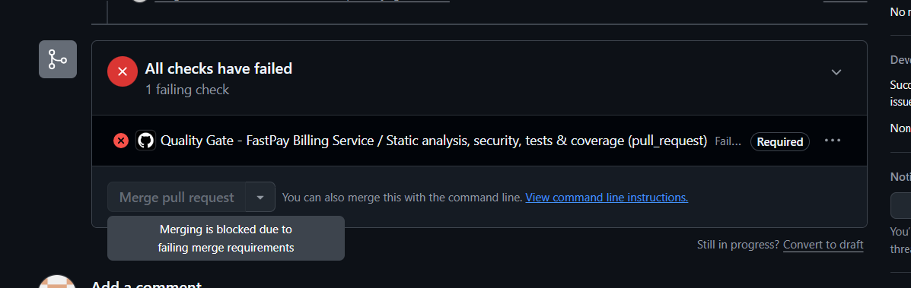
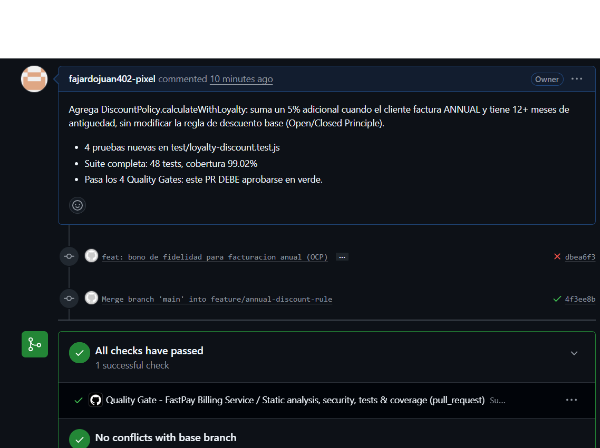

# Informe Técnico de Auditoría Forense y Plan de Remediación Continua
> **Cliente:** FastPay Global Inc.
> **Equipo Consultor:** Consultores Senior de Arquitectura y Calidad de Software
> **Fecha:** 26/10/2026
> **Repositorio Auditado:** https://github.com/fajardojuan402-pixel/Taller_Deuda
> **Commit Hash Base (código legacy de referencia):** `e272c43` (repositorio origen `NREYD/deuda_tecnica`) · `88e2d88` (commit inicial de este repositorio)
> **Commit Hash Remediado:** `2d63198` (suite completa con Quality Gates y pruebas de integración)

---

## 1. Resumen Ejecutivo

### 1.1 Diagnóstico de Situación

El microservicio `fastpay-billing-service` llegó a auditoría en estado crítico. Durante el último trimestre acumuló **17 horas de indisponibilidad**, **$49,470 USD en pérdidas directas** (reembolsos y penalizaciones) y **161 horas de ingeniería** consumidas en "apagar incendios". La causa raíz no es una falla puntual, sino **deuda técnica estructural**: un *God Method* (`processSubscriptionBilling`) con complejidad ciclomática de 22 que mezcla reglas de negocio, persistencia síncrona, impuestos y llamadas a pasarela; cálculos monetarios con coma flotante (IEEE 754); condiciones de carrera sobre un archivo JSON sin atomicidad que producían cobros múltiples; y secretos de API hardcodeados. La rotación del 60% del equipo es un síntoma directo de código *"imposible de entender, modificar o testear"* (violación transversal de **ISO/IEC 25010** en Mantenibilidad, Fiabilidad y Seguridad).

La remediación aplicó el **Ciclo de Vida de Gestión de Deuda Técnica (ISO/IEC/IEEE 12207)**: diagnóstico forense, cuantificación financiera, gobernanza, saneamiento con red de seguridad (Golden Master + Arquitectura Hexagonal) y blindaje con Quality Gates automatizados en CI/CD. El resultado es un servicio con dominio puro y desacoplado, cobro idempotente, aritmética monetaria exacta y una suite de 50 pruebas (unitarias, de caracterización y de integración HTTP) con **97.74% de cobertura global**.

### 1.2 Métricas Consolidadas de Deuda Técnica

| Métrica | Estado Inicial (Legacy) | Estado Final (Refactorizado) | Meta / Estándar |
| :--- | :--- | :--- | :--- |
| **Complejidad Ciclomática Máxima** | 22 | ≤ 8 | ≤ 8 |
| **Cobertura de Pruebas (Coverage)** | ~0% (2 tests frágiles) | 97.74% líneas / 94.17% ramas (dominio y aplicación ~99%) | ≥ 80% |
| **Nº de Pruebas Automatizadas** | 2 | 50 | — |
| **Vulnerabilidades Críticas / Altas (`npm audit`)** | 0 | 0 | 0 |
| **Violaciones de Linter (ESLint)** | 1 error + 2 warnings | 0 | 0 |
| **Cobros duplicados (5 peticiones concurrentes)** | 5 de 5 (quíntuple) | 1 de 5 (resto idempotente) | 1 |
| **Secretos hardcodeados** | 1 (API key en código) | 0 (variables de entorno) | 0 |
| **Technical Debt Ratio (TDR)** | 13.3% | ~0% (deuda saldada) | < 5.0% |

> **Evidencia inicial (lint legacy):** `Function 'processSubscriptionBilling' has a complexity of 22. Maximum allowed is 8`.
> **Evidencia inicial (simulación):** 5 de 5 cobros exitosos, saldo corrupto de `$1771.7405 USD`, totales con floats como `$325.7881` y `$361.4881`.

---

## 2. Inventario Formal y Clasificación de Deuda Técnica

| ID | Ubicación / Archivo | Tipo de Deuda | Descripción del Hallazgo / Smell | Cuadrante de Martin Fowler | Subcaracterística ISO/IEC 25010 | Principal (P) | Interés recurrente |
| :--- | :--- | :--- | :--- | :--- | :--- | :--- | :--- |
| **DT-01** | `legacy_billing_engine.js` (`processSubscriptionBilling`) | Código | *God Method* con complejidad ciclomática 22: mezcla validación, impuestos, descuentos, pasarela y persistencia. | Deliberada - Temeraria | Mantenibilidad (Modificabilidad, Analizabilidad) | 16 h | 40 h/trim por regresiones (INC-2026-0815) |
| **DT-02** | `legacy_billing_engine.js:L12` + `console.log` en fallo | Seguridad | API key `sk_live_...` hardcodeada e impresa en logs. | Deliberada - Temeraria | Seguridad (Confidencialidad) | 4 h | $3,500 por filtración (INC-2026-0829) |
| **DT-03** | `legacy_billing_engine.js` (`fs.writeFileSync` sin lock) | Arquitectura / Concurrencia | Persistencia no atómica + estado global mutable: race condition → cobro múltiple. | Inadvertida - Temeraria | Fiabilidad (Tolerancia a fallos) | 24 h | $8,750 + 26 h (INC-2026-0704) |
| **DT-04** | `legacy_billing_engine.js` (`fs.readFileSync` en bucle) | Desempeño / Resiliencia | I/O síncrono bloqueante del Event Loop; sin timeout/retry/circuit breaker. | Deliberada - Temeraria | Eficiencia de Desempeño (Comportamiento temporal) | 12 h | $14,200 + 34 h (INC-2026-0718) |
| **DT-05** | `legacy_billing_engine.js` (cálculo monetario) | Código / Exactitud | *Primitive Obsession*: dinero como `float`. `0.1 + 0.2 !== 0.3` → saldos inconsistentes. | Inadvertida - Temeraria | Adecuación Funcional (Exactitud) | 10 h | $4,920 + 28 h (INC-2026-0912) |
| **DT-06** | `test/legacy.test.js` | Pruebas | Solo 2 tests frágiles, sin invariantes de negocio ni bordes. | Deliberada - Temeraria | Mantenibilidad (Testeabilidad) | 14 h | 20 h/trim por bugs no detectados |

**Principal total estimado:** 16 + 4 + 24 + 12 + 10 + 14 = **80 horas**.

---

## 3. Análisis Forense de Incidentes y Cuantificación de "Intereses"

Basado en `fastpay-service/data/incidents-history.json` (6 incidentes del último trimestre):

### 3.1 Impacto Acumulado de la Inacción (Costo de los Intereses)

| Incidente | Downtime (h) | Pérdida (USD) | Ing. (h) |
| :--- | ---: | ---: | ---: |
| INC-2026-0704 (cobro duplicado) | 3.5 | 8,750 | 26 |
| INC-2026-0718 (bloqueo Event Loop) | 6.0 | 14,200 | 34 |
| INC-2026-0802 (timeout pasarela) | 2.0 | 6,300 | 18 |
| INC-2026-0815 (regresión por hotfix) | 4.5 | 11,800 | 40 |
| INC-2026-0829 (filtración credenciales) | 1.0 | 3,500 | 15 |
| INC-2026-0912 (floats en saldos) | 0.0 | 4,920 | 28 |
| **TOTAL** | **17.0 h** | **$49,470** | **161 h** |

* **Total Horas de Indisponibilidad (Downtime):** **17 horas**.
* **Pérdida Financiera Directa:** **$49,470 USD** por trimestre.
* **Horas de Ingeniería en "apagar incendios":** **161 horas** → a $45/h = **$7,245 USD**.
* **Costo total de Intereses del trimestre:** $49,470 + $7,245 = **$56,715 USD** (≈ **$18,905 USD/mes**).

### 3.2 Cálculo Matemático del Technical Debt Ratio (TDR)

$$ \text{TDR} = \frac{\text{Costo de Remediación (Principal)}}{\text{Costo Total de Desarrollo del Sistema}} \times 100 $$

* **Principal (P):** 80 h × $45/h = **$3,600 USD**.
* **Costo de Desarrollo del Sistema (C):** 600 h × $45/h = **$27,000 USD**.
* **TDR inicial:** $3,600 / $27,000 × 100 = **13.3%** (muy por encima del umbral saludable < 5%).

### 3.3 Retorno de Inversión (ROI)

El pago del Principal cuesta una sola vez **$3,600 USD**. Los Intereses que elimina ascienden a **≈ $18,905 USD/mes**. Por tanto:

$$ \text{ROI} = \frac{3{,}600}{18{,}905} \approx 0.19 \text{ meses} $$

El refactor **se paga a sí mismo en menos de 1 mes** (aproximadamente 6 días de operación sin incidentes). Cada mes adicional sin remediar, la empresa regala ~$18,905 USD en deuda acumulada.

---

## 4. Matriz de Priorización y Registro de Deuda Táctica

### 4.1 Matriz de Priorización (Impacto en Negocio vs. Esfuerzo)

```text
       ALTO IMPACTO
            ▲
            │  [DT-03 Concurrencia/Cobro duplicado]      [DT-01 God Method]
            │  (Prioridad 1 - Sprint 1)                  (Prioridad 2 - Sprint 1)
            │  [DT-05 Floats monetarios]
            │  (Prioridad 1 - Sprint 1)
            │
            │  [DT-02 Secretos hardcodeados]             [DT-04 I/O async + Resiliencia]
            │  (Quick Win - Prioridad 1)                 (Prioridad 3 - Sprint 2)
            │  [DT-06 Pruebas]
            │  (Habilitador - Sprint 1)
            └──────────────────────────────────────────────────────────►
           BAJO ESFUERZO                                      ALTO ESFUERZO
```

**Plan de pago inmediato (Sprint 1):** DT-02, DT-03, DT-05, DT-06, DT-01 (bloquean ingresos y reputación). **Diferido parcial (Sprint 2):** DT-04 en su variante de *circuit breaker* avanzado (el I/O ya se hizo asíncrono en Sprint 1).

### 4.2 Registro de Deuda Táctica Deliberada (Technical Debt Register)

* **ID del Registro:** `TDR-DEC-01`
* **Decisión Técnica:** Mantener la persistencia en **archivo JSON plano** (`FileSubscriptionRepository`) y simular la pasarela con un **mock en memoria** (`MockStripeGateway`), en lugar de migrar ya a una base de datos distribuida y al SDK real de Stripe.
* **Justificación de Negocio:** El bug de cobro duplicado y los floats (que causan la mayor parte de las pérdidas) se resuelven en la **capa de aplicación/dominio**, independientemente del motor de persistencia. Migrar la base de datos ahora multiplicaría el alcance del Sprint 1 sin reducir el riesgo inmediato.
* **Medida de Mitigación Temporal:** (a) escritura **atómica** (archivo temporal + `rename`) para evitar corrupción; (b) **mutex por suscripción** + **idempotencia** que serializan la concurrencia; (c) los puertos (`SubscriptionRepositoryPort`, `PaymentGatewayPort`) permiten sustituir los adaptadores sin tocar el dominio.
* **Fecha Límite de Pago (Debt Ceiling):** Sprint 3 (migración a PostgreSQL con transacciones nativas e integración del SDK real de Stripe).

---

## 5. Arquitectura de Remediación y Red de Seguridad

### 5.1 Red de Seguridad: Pruebas de Caracterización (Golden Master)

Antes de tocar el código de negocio se "congeló" el comportamiento válido del motor legacy ejecutándolo sobre `data/subscriptions.json` y capturando sus salidas reales.

* **Archivo de pruebas:** `fastpay-service/test/characterization.test.js`.
* **Casos de borde caracterizados:**
  * CO + ENTERPRISE con promo `FAST2026` → base 299.99 − 30 desc, IVA 19%, recargo 4.5 = **361.49 → 325.79** con descuento.
  * CO sin promo → **361.49**.
  * MX + PRO con tarjeta de crédito → IVA 16%, sin recargo (el recargo solo aplica a `WIRE_TRANSFER`) = **114.84**.
  * US + ENTERPRISE_PLUS ANNUAL → descuento 15%, tax 8.25% = **551.61**.
  * AR suspendida (tarjeta 9999) → `ERR_SUSPENDED`.
  * Suscripción inexistente → `ERR_SUB_NOT_FOUND`.

> Nota: el legacy producía totales como `325.7881` por el bug de floats. El Golden Master fija el valor **correcto redondeado a centavos** (`325.79`), que es el comportamiento válido esperado tras la remediación de DT-05.

**Composición de la suite (50 pruebas, cobertura global 97.74%):**

* **Unitarias de dominio** (`money.test.js`, `domain-policies.test.js`, `loyalty-discount.test.js`): Value Object `Money`, políticas de impuestos y descuentos, `BillingCalculator` y entidad `Subscription`.
* **Unitarias de aplicación** (`process-billing.test.js`): caso de uso de cobro, idempotencia, regresión de cobro duplicado y `KeyedMutex`.
* **De caracterización / Golden Master** (`characterization.test.js`): congela las reglas de negocio válidas.
* **De integración del repositorio** (`file-repository.test.js`): ejercita el adaptador de persistencia con escritura atómica sobre el sistema de archivos.
* **De integración del adaptador HTTP** (`http-adapter.integration.test.js`): levanta el servidor Express real (`buildApp.js`) en un puerto efímero e invoca los endpoints `/health`, `/api/subscriptions`, `/bill` y `/batch-run` con el cliente HTTP nativo, validando el adaptador de entrada de extremo a extremo con dobles inyectados (repositorio en memoria y gateway mock).

### 5.2 Estructura Hexagonal Implementada

```text
fastpay-service/src/
├── domain/                 # Entidades y reglas puras (sin Express ni fs)
│   ├── Money.js            # Value Object (centavos enteros) -> elimina floats
│   ├── Subscription.js     # Entidad con invariantes de estado
│   ├── TaxPolicy.js        # Reglas tributarias por país (OCP)
│   ├── DiscountPolicy.js   # Reglas de descuento por plan
│   └── BillingCalculator.js# Servicio de dominio puro (cálculo)
├── application/            # Casos de uso
│   ├── ProcessBillingUseCase.js   # Orquesta el cobro + idempotencia
│   ├── ListSubscriptionsUseCase.js
│   └── KeyedMutex.js       # Serializa concurrencia por suscripción
├── ports/                  # Interfaces abstractas (contratos)
│   ├── SubscriptionRepositoryPort.js
│   └── PaymentGatewayPort.js
└── infrastructure/         # Adaptadores concretos
    ├── FileSubscriptionRepository.js   # I/O async + escritura atómica
    ├── InMemorySubscriptionRepository.js
    ├── MockStripeGateway.js            # Secreto por env, nunca hardcodeado
    ├── config.js                       # Carga de variables de entorno
    ├── buildApp.js                     # Composition root (único acople a Express)
    └── server.js                       # Punto de entrada HTTP
```

### 5.3 Principios SOLID y Patrones Aplicados

* **Single Responsibility (SRP):** el *God Method* se dividió en `BillingCalculator` (cálculo), `TaxPolicy`/`DiscountPolicy` (reglas), `ProcessBillingUseCase` (orquestación), repositorio (persistencia) y gateway (pasarela). La complejidad bajó de **22 a ≤ 8**.
* **Open/Closed (OCP):** agregar un país o una promoción se hace extendiendo `TaxPolicy`/`DiscountPolicy`, sin modificar el núcleo de cálculo.
* **Dependency Inversion (DIP):** el dominio y la aplicación dependen de **puertos** abstractos; los adaptadores concretos se inyectan en el *composition root* (`buildApp.js`).
* **Value Object (resuelve DT-05):** `Money` representa el dinero en **centavos enteros** con redondeo bancario seguro; la prueba `0.1 + 0.2 === 0.3` pasa.
* **Idempotencia + Lock (resuelve DT-03):** `KeyedMutex` serializa las peticiones de una misma suscripción y `ProcessBillingUseCase` aplica una **clave de idempotencia** por período; 5 peticiones concurrentes producen **un solo cobro real** y 4 respuestas idempotentes.
* **Seguridad (resuelve DT-02):** el secreto se lee de `PAYMENT_GATEWAY_API_KEY` vía `config.js`; nunca se hardcodea ni se imprime en logs, y los errores 500 ya no filtran el stack.

---

## 6. Verificación de Quality Gates en GitHub Actions

### 6.1 Workflow de CI Implementado

* Archivo: `.github/workflows/quality-gate.yml`. Corre en cada `push` y `pull_request` hacia `main`.
* **Gate 1 — Lint (ESLint):** `npm run lint`. Bloquea si hay errores de complejidad, profundidad o `no-undef`.
* **Gate 2 — Seguridad:** `npm audit --audit-level=high`. Bloquea ante vulnerabilidades altas/críticas.
* **Gate 3 — Pruebas:** suite completa con `node --test`.
* **Gate 4 — Umbral de cobertura:** `scripts/check_coverage.js` parsea la cobertura global y hace **exit 1 si < 80%**, rechazando el merge.

### 6.2 Evidencias de Bloqueo y Aprobación

Se prepararon **dos ramas** en el repositorio para demostrar el comportamiento del Quality Gate. Cada una debe convertirse en un Pull Request hacia `main` desde la pestaña *Pull requests* de GitHub.

**1. Pull Request BLOQUEADO — rama `demo/quality-gate-fail`**

* **Fallo deliberado:** se añadió `fastpay-service/src/domain/BadDiscountRules.js`, una función con **complejidad ciclomática 12** (máximo permitido 8) y **anidamiento de 6 niveles** (máximo 3).
* **Resultado esperado:** al abrir el PR, **GATE 1 (ESLint)** falla y GitHub Actions marca el check en **rojo**; el merge a `main` queda bloqueado.
* **Verificación local reproducible:**
  ```text
  Function 'computeMessyDiscount' has a complexity of 12. Maximum allowed is 8   complexity
  Blocks are nested too deeply (6). Maximum allowed is 3                          max-depth
  ✖ 4 problems (4 errors, 0 warnings)
  ```
* **Abrir el PR:** `https://github.com/fajardojuan402-pixel/Taller_Deuda/compare/main...demo/quality-gate-fail`
* **Evidencia (PR bloqueado):** el check *Quality Gate* aparece en rojo con el mensaje *"All checks have failed"*, impidiendo el merge.



**2. Pull Request APROBADO — rama `feature/annual-discount-rule`**

* **Cambio legítimo:** se añadió `DiscountPolicy.calculateWithLoyalty` (bono de fidelidad del 5% para facturación anual con 12+ meses de antigüedad), aplicando el **Open/Closed Principle** sin modificar la regla base, con **4 pruebas nuevas**.
* **Resultado esperado:** los 4 gates pasan y GitHub Actions marca los checks en **verde**; el merge a `main` se permite.
* **Verificación local reproducible:** `npm run lint` → 0 problemas; `node scripts/check_coverage.js` → **48 tests, cobertura 99.02%, [QUALITY GATE] APROBADO**.
* **Abrir el PR:** `https://github.com/fajardojuan402-pixel/Taller_Deuda/compare/main...feature/annual-discount-rule`
* **Evidencia (PR aprobado):** el check *Quality Gate* aparece en verde con el mensaje *"All checks have passed"*, habilitando el merge.



> **Para que el bloqueo sea efectivo (recomendado):** en GitHub, ir a *Settings → Branches → Add branch protection rule*, patrón `main`, y activar *"Require status checks to pass before merging"* seleccionando el check **"Quality Gate - FastPay Billing Service"**. Así el PR rojo no podrá fusionarse hasta corregir el fallo.

> Evidencia local reproducible del estado sano de `main` (misma lógica que corre en CI):
> * `npm run lint` → 0 problemas.
> * `npm audit --audit-level=high` → `found 0 vulnerabilities`.
> * `node scripts/check_coverage.js` → `[QUALITY GATE] APROBADO`, 50 tests, cobertura 97.74% líneas.

---

## 7. Conclusiones y Gobernanza Continua (ISO/IEC/IEEE 12207)

**1. ¿Cómo previene la Arquitectura Hexagonal + Value Objects la reaparición de la deuda inadvertida?**
Al aislar el dominio detrás de puertos, los cambios de infraestructura (base de datos, pasarela) no pueden filtrarse hacia las reglas de negocio, lo que evita el acoplamiento que originó el *God Method*. El Value Object `Money` hace **imposible por construcción** volver a operar dinero con floats: cualquier intento de usar un decimal crudo rompe el tipo y lo detecta una prueba. La red de 50 tests con 97.74% de cobertura actúa como alarma temprana ante regresiones.

**2. Ante una fecha límite agresiva para una nueva pasarela, ¿cuál es el procedimiento para contraer deuda deliberada sin caer en negligencia?**
Seguir el proceso formal usado en `TDR-DEC-01`: (a) documentar la decisión en el Technical Debt Register con justificación de negocio; (b) definir una **medida de mitigación** (aquí: mock tras un puerto, idempotencia, escritura atómica); (c) fijar un **Debt Ceiling** (fecha límite de pago); y (d) hacer visible el ítem en el backlog. La deuda deliberada es prudente cuando es **consciente, medida y con fecha de vencimiento**; es negligente cuando es silenciosa e indefinida.

**3. ¿Cómo justificar ante el CFO invertir ~20% de cada sprint en pagar deuda técnica?**
Con los números de esta auditoría: el Principal costó **$3,600** una sola vez y elimina **~$18,905/mes** de Intereses (pérdidas + horas de bomberos), con un ROI inferior a un mes. Mantener un TDR < 5% y los Quality Gates evita que vuelvan a producirse incidentes como el cobro quíntuple o el bloqueo del Event Loop. Invertir el 20% de capacidad en deuda no es un costo: es el seguro que protege los ingresos recurrentes y la reputación de FastPay.
